# Honda CRV (1st Gen, RD1) for Project Zomboid

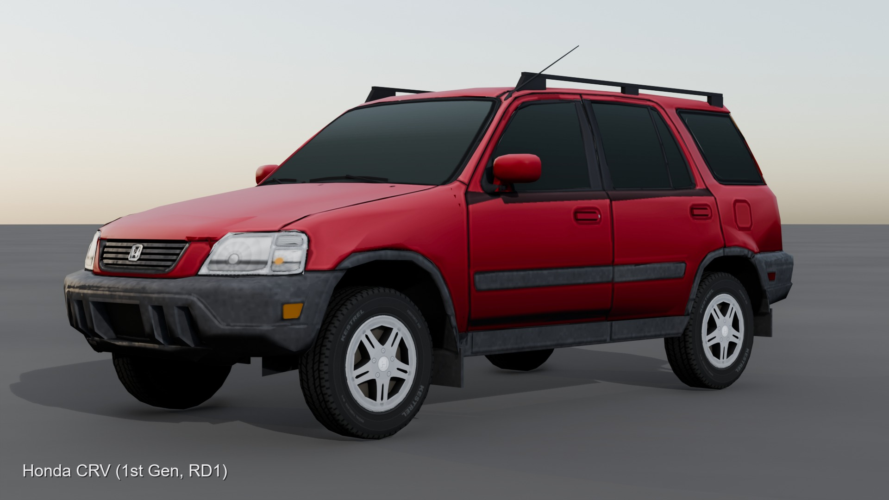

I really like the first-gen CRV and I wanted one in Zomboid, so I made it. It's the 1997-2001 RD1 with
real-time 4WD, the side-hinged tailgate with the spare hanging off it, the picnic table hidden under the
cargo floor, and a B20B that just won't quit.

This repo is everything behind the mod: the shipped mod itself, and the Blender and Python pipeline that
builds it from a source mesh to the files the game loads.

**[Get it on the Steam Workshop](https://steamcommunity.com/sharedfiles/filedetails/?id=3822496833)**:
Build 42, no other mods needed.

---

## What's in it

**The car**
- All eight factory colours, from Electron Blue Pearl to Naples Gold
- Every door, the hood and the tailgate open. A prop rod holds the hood up, and the rear glass lifts
  with the side-hinged gate
- A new engine bay, modelled from photos of a real B20B
- Its own engine sound, horn and door sounds, and its own damage, rust and blood textures
- Proper headlights, and tail lights that light up on the brake
- Fold the back seats flat into a bed you can sleep in
- A storage well under the cargo floor
- An owner's manual in every glove box, with the last owner's notes in the margins

**The picnic table**
- Take it out from under the cargo floor and set it up behind the tailgate. It's a real 3D model
  you can put things on

**Off-road**
- A 3 inch lift on 30 inch all-terrain tyres, on the stock alloys or black steelies. It comes off
  again, and you keep your parts and whatever is in the trunk
- Bull bar, snorkel, skid plate, steel rear bumper with a hitch, and a ladder up to the roof rack
- Jerry cans on the tailgate and in the roof rack that hold real fuel
- Find the kit as rare loot, build it at a workbench, or learn it from a magazine

**Armour**
- Bolt-on door plates, window mesh, arch guards and a rear glass plate. Heavy bare steel that zombies
  can't reach through

**Everything else**
- Spawns in suburbs, on farm roads, in parking lots and in traffic jams
- Sandbox options for spawn rate, accessory chance, loot rarity, armour strength and engine volume
- Built for multiplayer (dedicated server testing is still in progress)
- Works with [Project Viewpoint](https://steamcommunity.com/sharedfiles/filedetails/?id=3809306528)
  first and third person: the cabin and the panels are closed from eye level and from the seats

## Pictures

| | |
|---|---|
| 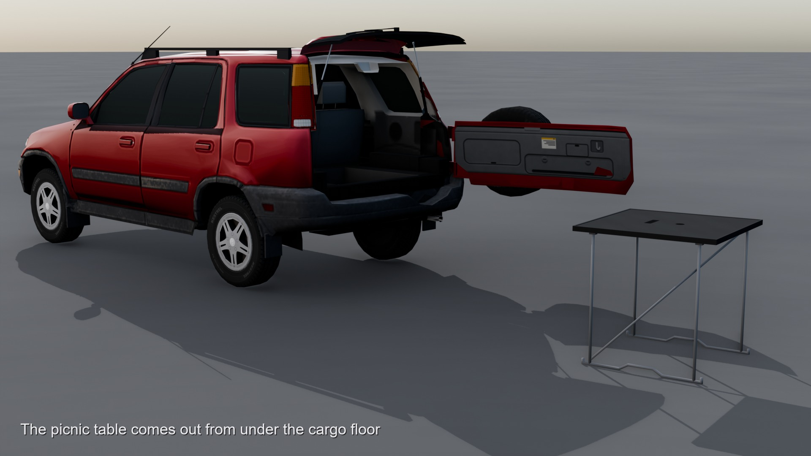 | 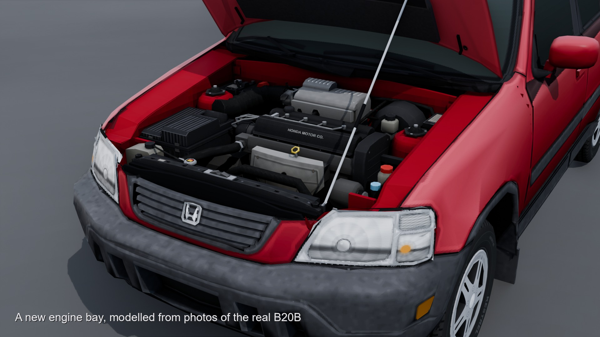 |
| The picnic table comes out from under the cargo floor | A new engine bay, modelled from photos of the real B20B |
| 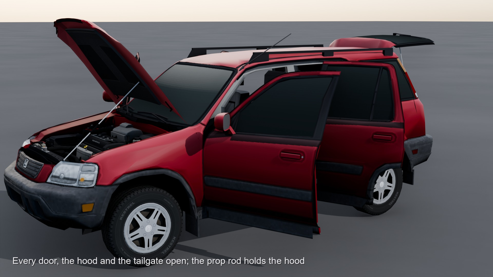 | 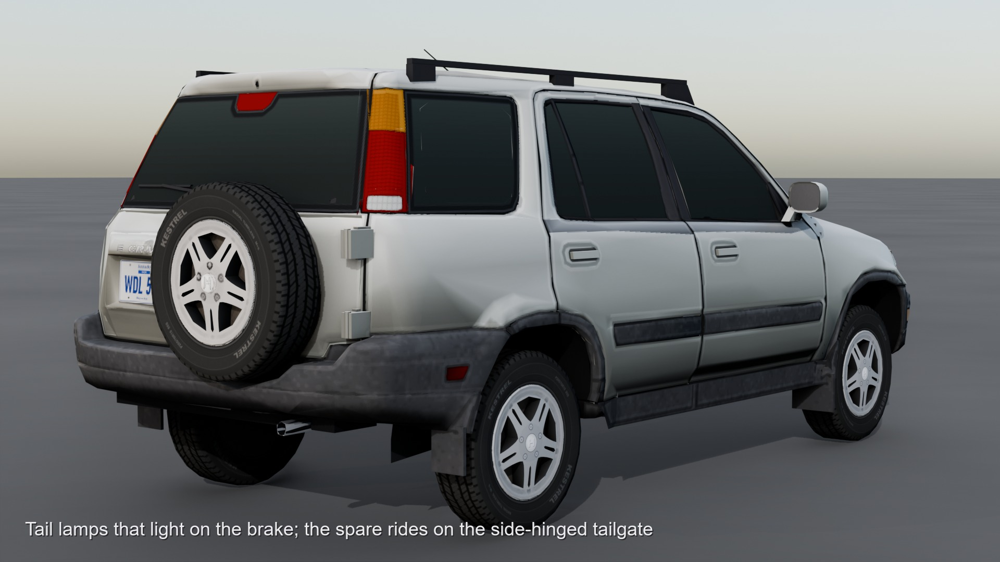 |
| Every door, the hood and the tailgate open | Side-hinged tailgate with the spare on it |
| 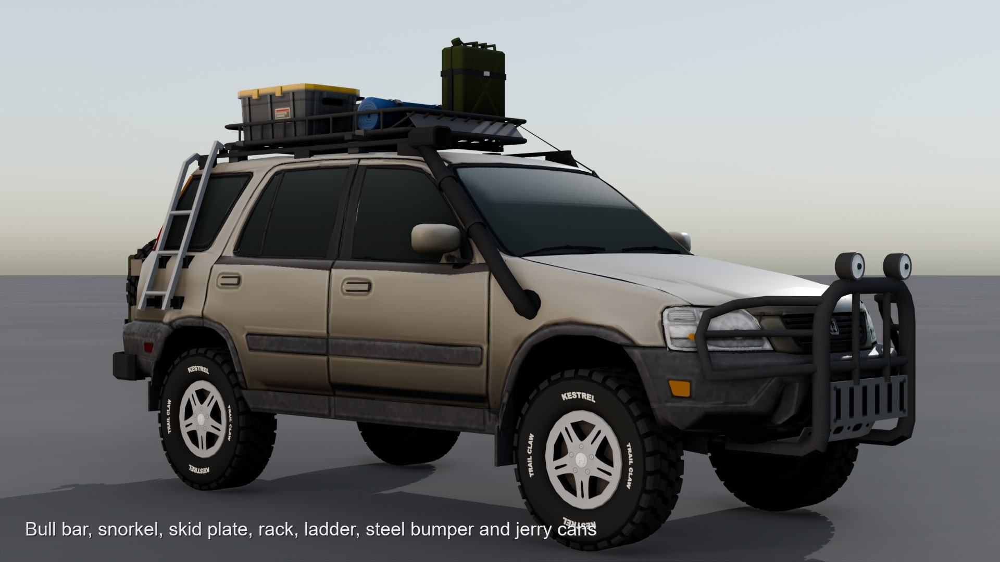 | 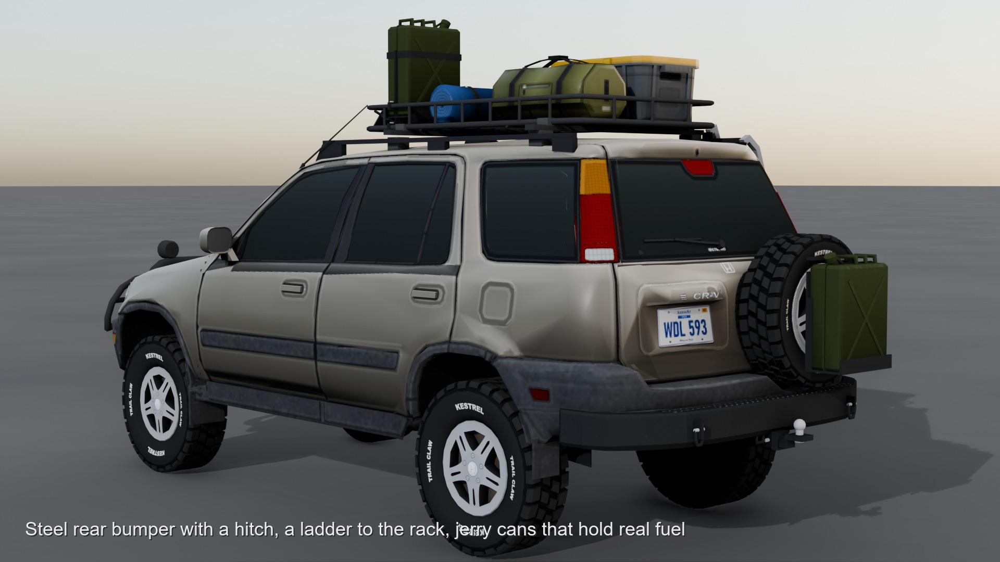 |
| Bull bar, snorkel, skid plate, rack and ladder | Steel rear bumper, hitch, jerry cans |
| 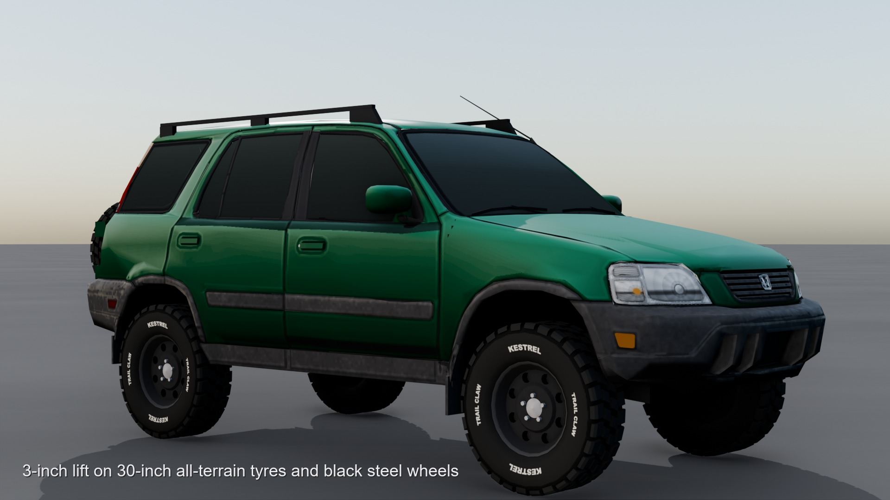 | 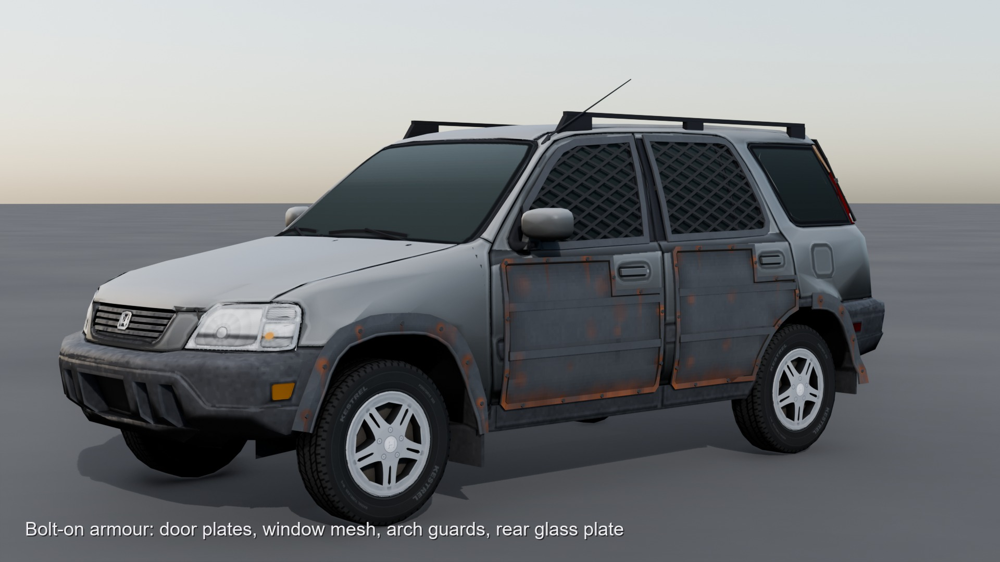 |
| 3 inch lift on all-terrain tyres and black steelies | Bolt-on armour |
| 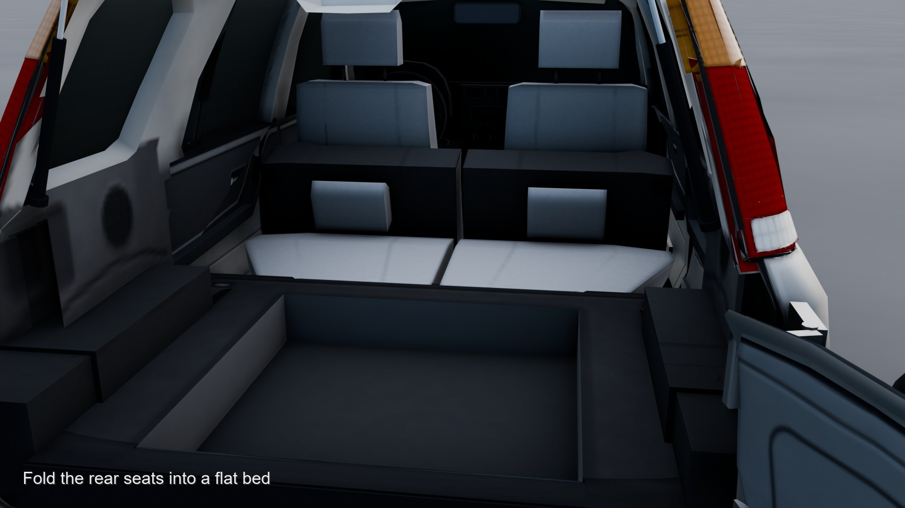 | 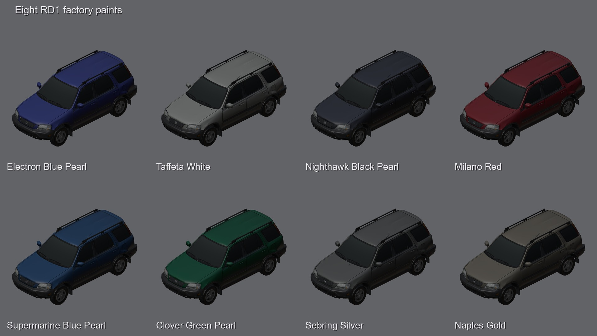 |
| Fold the rear seats into a flat bed | Eight RD1 factory paints |
| 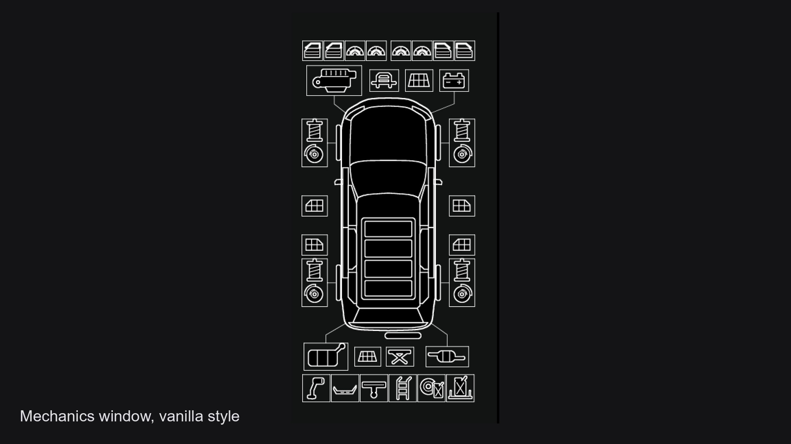 | 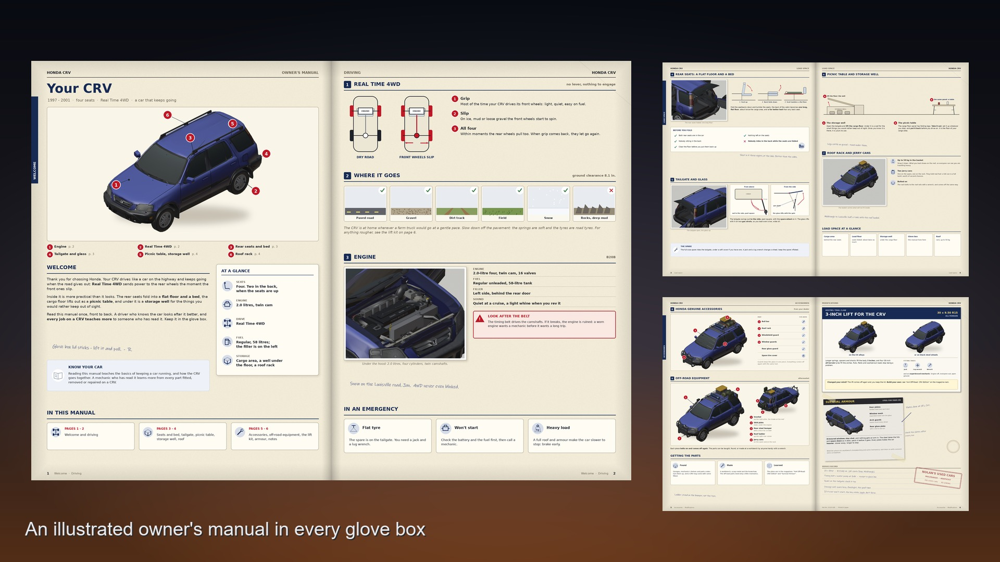 |
| Its own mechanics screen, accessories included | An illustrated owner's manual in every glove box |

## Install

Subscribe on the [Steam Workshop](https://steamcommunity.com/sharedfiles/filedetails/?id=3822496833) and
enable **Honda CRV (1st Gen)** in the mod list.

To install by hand, copy `mod/Contents/mods/HondaCRVGen1` into `%USERPROFILE%\Zomboid\mods\`.

## How it's made

The car is generated, not hand-edited. One command rebuilds everything from the source mesh and checks
the result:

```
python scripts/build.py --sync
```

It runs in eight steps, each one a script you can run alone (`--from` / `--to` pick a range):

| Step | What it does |
|---|---|
| `rebuild` | Splits the source mesh into the game's parts (body, four doors, hood, tailgate, glass), builds the engine bay, cabin, wheel arch liners and accessories, closes every panel so nothing is see-through, and decimates each part to a polygon budget with its own decimator |
| `bake` | Unwraps every part and bakes colour, ambient occlusion, cavity, lamps and lettering from the full-detail model onto the low one |
| `compose` | Builds the shipped texture sheets: paint, weathering, panel gaps, damage, rust and blood, and the lamp and glass masks |
| `export` | Rigs the opening panels and writes the FBX files the game loads |
| `scripts` | Generates the vehicle scripts, items, recipes, loot and translations |
| `overlays` | Draws the mechanics screen and the item icons |
| `tiles` | Renders the placed picnic table's tile and 3D model |
| `check` | Audits the mod and renders it with `pzview.py` |

A few parts of the pipeline worth a look:

- **`scripts/pzview.py`** renders the car the way the game draws it, using only the shipped files. It
  rebuilds the car from the vehicle script, poses the panels with the shipped animations, and culls
  back faces like the game. It counts every pixel where you could see through the car, from the game
  camera, from eye level and from every seat. The rules it follows were read from the game's
  bytecode, not guessed.
- **`scripts/lowpoly.py`** is the decimator. Blender's own flipped and folded triangles at these
  ratios, which the game's back-face culling turned into holes.
- **`scripts/backfill.py`** finds every face a camera can see from behind and gives it a back, so
  nothing is see-through from any angle.
- **`scripts/features/`** holds the add-ons (lift, off-road, armour, the folding bed, polish). Each
  one is a plugin that adds its own meshes, scripts, Lua and tests to the build.
- **`scripts/beauty.py`** renders the gallery pictures above from the shipped files, in EEVEE.

The Lua is tested outside the game: `python scripts/test_all_lua.py` runs every mod script against
mocks of the game's API under Lua 5.1.

In numbers: 108 Python scripts (about 51,000 lines), 3,500 lines of Lua, 376 commits since September
2026.

### Things we learned about the game

Some of what the game and its mods do isn't written down anywhere. These were found in the bytecode,
and the scripts' comments hold the details:

- Vehicles always cull back faces, whatever the model script says.
- A static FBX mesh binds its vertex elements by position, so the `vehiclewheel` shader reads the
  *second* UV layer.
- Model textures are never mipmapped, and they're halved to the player's texture size option.
  Which option applies depends on whether the shader's name starts with `vehicle`.
- The game only computes bounds for static meshes. Project Viewpoint therefore culls every skinned part
  (doors, windows, hood, tailgate) with a sphere of 2 x the model scale at the model's origin. At the
  usual 10 units per metre that sphere is 18 cm, and the doors vanish in first person. This car
  exports at 0.5 units per metre with script scale 2.0, so the sphere covers the whole car.

## Repository layout

| Path | What's there |
|---|---|
| `mod/` | The Workshop item: `workshop.txt`, `preview.png` and `Contents/mods/HondaCRVGen1` (`42/` scripts, Lua, translations; `common/` models, textures, shaders) |
| `scripts/` | The build pipeline, checkers and tests |
| `scripts/features/` | Feature plugins: lift, off-road, armour, function, polish |
| `listing/` | The Workshop description and gallery |

Building from source needs Blender 4.5 LTS and Python 3 with Pillow and NumPy (and lupa for the Lua
tests). Copy `local_paths.example.json` to `local_paths.json` and set where Blender and the game are
installed. The pipeline's working `.blend` files aren't in this repo. They start from the source mesh
credited below.

## Credits

- Vehicle mesh based on ["Honda CR-V 2001"](https://sketchfab.com/3d-models/3565e8277a484f14b45c6888ca61a2b2)
  by kotris666 on Sketchfab, licensed [CC BY 4.0](https://creativecommons.org/licenses/by/4.0/). It was
  split into game parts, decimated, re-unwrapped and retextured. The engine bay, cabin furniture,
  accessories and every texture are original.
- Surface grain from [Poly Haven](https://polyhaven.com) (CC0).
- The shipped shaders are generated from the game's own vehicle shaders, for use in Project Zomboid mods.

**AI disclosure:** I made this with AI (Claude, by Anthropic). I directed it and tested everything in
game.

Honda, CR-V and the H emblem are trademarks of Honda Motor Co., used here in a free fan mod. This
project isn't affiliated with Honda or The Indie Stone.
